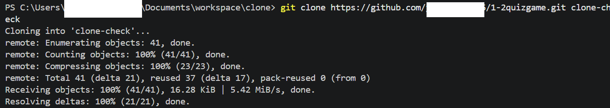
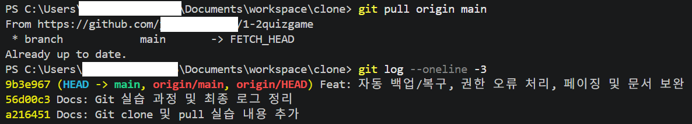

# 🎯 나만의 파이썬 퀴즈 게임 (Python Console Quiz Game)

## 📌 1. 프로젝트 개요

-   Python 기본 문법과 객체 지향(클래스)을 활용하여 터미널에서 동작하는
    콘솔 기반 퀴즈 게임입니다.
-   `state.json` 파일을 통해 프로그램을 종료해도 퀴즈 데이터와 최고
    점수가 유지되는 **데이터 영속성**을 구현했습니다.
-   `try/except`를 활용한 강력한 예외 처리와 Git 브랜치 전략, GitHub
    협업 워크플로우를 실습합니다.

### 💡 퀴즈 주제 선정 이유

-   **주제:** 파이썬 및 IT 개발 기초 상식
-   **선정 이유:** 프로그래밍 입학 연수 과정에서 학습한 핵심 개념들을
    직접 퀴즈 문제로 출제하고 풀어봄으로써, 지식을 자연스럽게 복습하고
    콘솔 응용 프로그램 구조를 체득하기 위해 이 주제를 선정했습니다.

------------------------------------------------------------------------

## 💻 2. 실행 환경

  항목          환경
  ------------- -------------------------------
  OS            Windows 11
  터미널        VS Code Terminal / PowerShell
  언어          Python 3.12.8
  데이터 저장   JSON (`state.json`, UTF-8)
  버전 관리     Git 2.56.0.windows.4 / GitHub

------------------------------------------------------------------------

## 🚀 3. 실행 방법

프로젝트 루트 폴더에서 터미널을 열고 아래 명령어를 입력하여 실행합니다.

``` powershell
python main.py
```

------------------------------------------------------------------------

## 🛠️ 4. 기능 목록

1.  **퀴즈 풀기:** 저장된 퀴즈를 **매번 랜덤한 순서로 섞어** 출제하고
    정답 여부 확인 및 최종 점수 산출 (최고 점수 자동 갱신)
2.  **퀴즈 추가:** 새로운 문제, 4개의 선택지, 정답 번호를 입력받아 즉시
    `state.json`에 저장
3.  **퀴즈 목록:** 현재 등록된 모든 퀴즈 목록 조회
4.  **점수 확인:** 역대 최고 점수 및 정답 개수 확인
5.  **안전한 예외/오류 처리:** 잘못된 숫자 입력, 빈 값, 문자 입력, 파일
    손상 시 안내 및 안전 종료(`Ctrl+C` 대응) 지원
6.  **자동 백업/복구:** 저장할 때마다 `state.json.bak`을 자동 생성하고,
    손상 시 백업에서 복원 (절차는 9장 참고)
7.  **권한 오류 처리:** 읽기/쓰기 권한이 없을 때 프로그램이 중단되지 않고
    원인과 해결 방법을 안내
8.  **목록 페이징:** 퀴즈가 많아져도 20개씩 나누어 조회
    (`Enter`: 다음 페이지, `q`: 종료)
9.  **랜덤 출제:** 퀴즈 풀기 시작 때마다 `random` 모듈로 문제 순서를 섞어
    같은 순서로 외워서 푸는 것을 방지 (상세 내용은 12장 참고)

-   **Tip:** `state.json` 파일이 자동 생성되므로 언제든 이어서 학습할 수
    있습니다.

------------------------------------------------------------------------

## 📂 5. 파일 구조 및 데이터 파일 설명

### 파일 구조

``` text
quiz-game/
├── .gitignore         # Git 추적 제외 설정 (__pycache__, venv 등)
├── README.md          # 프로젝트 설명서 및 실행 기록
├── state.json         # 퀴즈 데이터 및 최고 점수 저장 파일 (자동 생성/관리)
├── state.json.bak     # 저장 시 자동 생성되는 직전 정상본 백업
├── state.json.corrupt # (손상 발생 시에만) 손상된 원본 보관본
├── docs/images/       # 실습 증빙 스크린샷 (clone / pull 성공 화면)
└── main.py            # 프로그램 실행 및 게임 로직 진입점
```

-   **Tip:** UTF-8 인코딩을 사용하여 한글이 깨지지 않고 안전하게
    저장됩니다.

### 데이터 파일 (`state.json`) 설명

-   **경로:** 프로젝트 루트 (`./state.json`)

-   **역할:** 프로그램 종료 후에도 퀴즈 목록과 최고 점수를 보존하는
    영속성 저장소 (UTF-8 인코딩)

-   **최소 스키마 구조:**

    ``` json
    {
        "quizzes": [
            {
                "question": "문제 내용",
                "choices": ["선택지1", "선택지2", "선택지3", "선택지4"],
                "answer": 1,
                "points": 1
            }
        ],
        "best_score": 0
    }
    ```

-   `points`(문항 배점)는 선택 항목이며, 없으면 기본값 1로 처리되어
    기존 `state.json`과 호환됩니다.
-   `state.json.bak`, `state.json.corrupt`, `state.json.tmp`는 실행 중
    자동 생성되는 파일이므로 `.gitignore`에 추가합니다.

    ``` text
    state.json.bak
    state.json.corrupt
    state.json.tmp
    ```

------------------------------------------------------------------------

## ✅ 6. 수행 항목 체크리스트

-   [x] GitHub 저장소 생성 및 로컬 연결
-   [x] .gitignore, README.md 작성
-   [x] 초기 설정 후 첫 commit / push 수행
-   [x] 메뉴 출력 및 기능 선택 구현
-   [x] 잘못된 입력 / 예외 처리 구현
-   [x] Quiz 클래스 정의 (question, choices, answer)
-   [x] 기본 퀴즈 데이터 5개 이상 작성 (총 10개 구성 완료)
-   [x] 퀴즈 풀기 기능 (브랜치 생성 후 작업 → 병합)
-   [x] 퀴즈 풀기 시 문제 순서 랜덤 출제 (`random.sample`)
-   [x] 퀴즈 추가 기능 및 파일 저장
-   [x] 퀴즈 목록 확인 기능
-   [x] 점수 확인 및 최고 점수 갱신·저장
-   [x] state.json 영속성 검증 (재실행 후 데이터 유지)
-   [x] 파일 없음 / 손상 시 복구 처리
-   [x] 자동 백업(`.bak`) 및 백업 기반 복구, 권한 오류 처리
-   [x] 대용량(1,000개 이상) 대비 성능·메모리 측정 및 개선안 문서화
-   [x] 요구사항 변경 영향도 가이드 문서화
-   [x] Clone / Pull 성공 화면 스크린샷 및 실행 로그 첨부 (`docs/images/`, ⑩)
-   [x] 10개 이상 의미 있는 커밋 완료
-   [x] 커밋 단위 규정 및 메시지 템플릿 문서화 (13장)
-   [x] 브랜치 생성·병합 1회 이상 완료
-   [x] clone, pull 각 1회 이상 완료
-   [x] README.md 필수 항목 모두 작성

------------------------------------------------------------------------

## 📜 7. 단계별 수행 내용 및 실행 로그

### ① 프로젝트 폴더 초기화 및 GitHub 원격 저장소 연결

``` powershell
PS C:\Users\usr\Documents\Workspace> python --version
Python 3.12.8
PS C:\Users\usr\Documents\Workspace> git --version
git version 2.56.0.windows.4
PS C:\Users\usr\Documents\Workspace> mkdir quiz-game
PS C:\Users\usr\Documents\Workspace> cd quiz-game

PS C:\Users\usr\Documents\Workspace\quiz-game> git init
PS C:\Users\usr\Documents\Workspace\quiz-game> git remote add origin https://github.com/usr/1-2quizgame.git 
PS C:\Users\usr\Documents\Workspace\quiz-game> git remote -v
origin  https://github.com/usr/1-2quizgame.git (fetch)
origin  https://github.com/usr/1-2quizgame.git (push)
```

### ② 설정 파일 생성 및 첫 커밋/푸시 수행 (커밋 #1)

``` powershell
PS C:\Users\usr\Documents\Workspace\quiz-game> New-Item .gitignore -ItemType File
PS C:\Users\usr\Documents\Workspace\quiz-game> New-Item README.md -ItemType File
PS C:\Users\usr\Documents\Workspace\quiz-game> git add .
PS C:\Users\usr\Documents\Workspace\quiz-game> git commit -m "Chore: 프로젝트 초기 설정 및 기본 파일 생성"
[main (root-commit) 3ed5d89] Chore: 프로젝트 초기 설정 및 기본 파일 생성
 2 files changed, 10 insertions(+)

PS C:\Users\usr\Documents\Workspace\quiz-game> git push -u origin main
To https://github.com/usr/1-2quizgame.git
 * [new branch]      main -> main
branch 'main' set up to track 'origin/main'.
```

### ③ 핵심 로직(`main.py`) 구현 및 퀴즈 풀이/예외 처리 검증 (커밋 #2)

-   `state.json` 미존재 시 기본 데이터(5문제) 자동 생성 검증
-   퀴즈 5문제 풀이 후 점수 산출 및 최고 점수 갱신(`3점`) 확인
-   잘못된 입력(`ㅁ`, `a`, `9`)에 대한 예외 처리 안내 메시지 동작 검증

``` powershell
PS C:\Users\usr\Documents\Workspace\quiz-game> python main.py
📂 state.json 파일이 없어 기본 데이터로 생성합니다.
========================================
        🎯 나만의 퀴즈 게임 🎯        
📂 저장된 데이터 로드 완료 (퀴즈 5개, 최고점수: 0점)
========================================

1. 퀴즈 풀기
2. 퀴즈 추가
3. 퀴즈 목록
4. 점수 확인
5. 종료
========================================
선택: 1

📝 퀴즈를 시작합니다! (총 5문제)
... (중략) ...
========================================
🏆 결과: 총 5문제 중 3문제 정답!
🎉 새로운 최고 점수입니다!
========================================

선택: 4
🏆 최고 점수: 3점

선택: ㅁ
⚠️ 숫자 형태만 입력 가능합니다.
선택: a
⚠️ 숫자 형태만 입력 가능합니다.
선택: 9
⚠️ 잘못된 입력입니다. 1~5 사이의 숫자를 입력하세요.
선택: 5
👋 프로그램을 종료합니다. 이용해 주셔서 감사합니다!

PS C:\Users\usr\Documents\Workspace\quiz-game> git add main.py
PS C:\Users\usr\Documents\Workspace\quiz-game> git commit -m "Feat: Quiz 및 QuizGame 클래스, 예외 처리, 파일 영속성 구현"
[main 9e29fb9] Feat: Quiz 및 QuizGame 클래스, 예외 처리, 파일 영속성 구현
 1 file changed, 234 insertions(+)
 create mode 100644 main.py
```

### ④ 작업 브랜치 생성 및 퀴즈 5개 추가·목록 조회 검증 (커밋 #3)

-   `feature/quiz-features` 브랜치 생성 및 전환
-   재실행 시 기존 `state.json` 데이터(5문제, 최고점수 3점) 유지 확인
-   퀴즈 5개를 추가 등록하여 총 10문제 목록 조회 및 저장 검증
-   `.gitignore` 예외 처리를 위해 `git add -f state.json`으로 데이터
    파일 추적 반영

``` powershell
PS C:\Users\usr\Documents\Workspace\quiz-game> git checkout -b feature/quiz-features
Switched to a new branch 'feature/quiz-features'
PS C:\Users\usr\Documents\Workspace\quiz-game> python main.py
========================================
        🎯 나만의 퀴즈 게임 🎯        
📂 저장된 데이터 로드 완료 (퀴즈 5개, 최고점수: 3점)
========================================
... (퀴즈 5개 추가 진행) ...
선택: 3

📋 등록된 퀴즈 목록 (총 10개)
----------------------------------------
[1] Python에서 리스트(List)의 특징으로 알맞은 것은?
[2] 다음 중 파이썬의 기본 데이터 타입이 아닌 것은?
[3] 깃(Git)에서 로컬 저장소의 변경 이력을 원격 저장소에 업로드하는 명령어는?
[4] 다음 중 파일 권한 '644'에서 소유자(Owner)가 가진 권한으로 올바른 것은?
[5] Docker 컨테이너를 실행할 때 포트를 매핑하기 위해 사용하는 옵션은?
[6] 파이썬에서 함수의 반환값을 지정할 때 사용하는 키워드는?
[7] Git에서 새로운 브랜치를 생성하고 동시에 해당 브랜치로 이동하는 명령어는?
[8] 실행 중인 모든 Docker 컨테이너의 목록을 확인할 수 있는 명령어는?
[9] 리눅스에서 파일 소유자에게는 읽기·쓰기·실행, 그룹과 기타 사용자에게는 읽기·실행 권한을 부여하는 숫자 표현은?
[10] 파이썬에서 예외 처리를 위해 사용하는 블록의 키워드가 아닌 것은?
----------------------------------------
선택: 5
👋 프로그램을 종료합니다. 이용해 주셔서 감사합니다!

PS C:\Users\usr\Documents\Workspace\quiz-game> git add -f state.json
PS C:\Users\usr\Documents\Workspace\quiz-game> git add README.md
PS C:\Users\usr\Documents\Workspace\quiz-game> git commit -m "Feat: 퀴즈 데이터(state.json) 및 README 문서 업데이트"
[feature/quiz-features e73b1f3] Feat: 퀴즈 데이터(state.json) 및 README 문서 업데이트
 2 files changed, 232 insertions(+)
 create mode 100644 state.json
```

### 10번째 커밋 로그 (README 참고용)

``` powershell
PS C:\Users\usr\Documents\Workspace\quiz-game> git add README.md
PS C:\Users\usr\Documents\Workspace\quiz-game> git commit -m "Docs: README.md 최종 수정 및 문서 정돈 완료"
[feature/quiz-features a83f2c5] Docs: README.md 최종 수정 및 문서 정돈 완료
 1 file changed, 10 insertions(+), 9 deletions(-)
PS C:\Users\usr\Documents\Workspace\quiz-game> git rev-list --count HEAD
10
```

## 📌 8. Git Clone 및 Pull 실습

-   GitHub 원격 저장소를 별도 폴더에 Clone하여 프로젝트 복제 확인
-   Clone한 저장소에서 main 브랜치 및 프로젝트 파일 확인
-   원격 저장소의 변경 사항을 Pull하여 로컬 저장소에 반영하는 실습 진행

### ⑤ 작업 브랜치 Push 및 병합 과정

-   `feature/quiz-features` 브랜치의 작업 내용을 원격 저장소에 Push
-   처음 `main` 브랜치로 이동하려 했으나, 커밋하지 않은 `README.md` 변경
    사항이 있어 checkout이 중단됨
-   당시 feature 브랜치에서 자기 자신을 병합하여 `Already up to date`가
    출력됨
-   이후 README 변경 사항을 커밋한 뒤 `main`으로 이동하여 정상적으로
    병합 진행

``` powershell
PS C:\Users\usr\Documents\Workspace\quiz-game> git push origin feature/quiz-features
Enumerating objects: 30, done.
Counting objects: 100% (30/30), done.
Delta compression using up to 24 threads
Compressing objects: 100% (28/28), done.
Writing objects: 100% (28/28), 11.23 KiB | 2.81 MiB/s, done.
Total 28 (delta 14), reused 0 (delta 0), pack-reused 0 (from 0)
remote: Resolving deltas: 100% (14/14), done.
remote:
remote: Create a pull request for 'feature/quiz-features' on GitHub by visiting:
remote:      https://github.com/usr/1-2quizgame/pull/new/feature/quiz-features
remote:
To https://github.com/usr/1-2quizgame.git
 * [new branch]      feature/quiz-features -> feature/quiz-features

PS C:\Users\usr\Documents\Workspace\quiz-game> git checkout main
error: Your local changes to the following files would be overwritten by checkout:
        README.md
Please commit your changes or stash them before you switch branches.
Aborting

PS C:\Users\usr\Documents\Workspace\quiz-game> git merge feature/quiz-features
Already up to date.

PS C:\Users\usr\Documents\Workspace\quiz-game> git push origin main
Total 0 (delta 0), reused 0 (delta 0), pack-reused 0 (from 0)
To https://github.com/usr/1-2quizgame.git
   3ed5d89..9e29fb9  main -> main
```

위 로그에서 `git checkout main`은 실패했으므로, 그 시점에는 feature
브랜치에 그대로 남아 있었습니다. 따라서 이어서 실행한
`git merge feature/quiz-features`는 실제 main 병합이 아니었습니다.

### ⑥ README 변경사항 커밋 후 main 병합 및 Push

-   `README.md` 변경사항을 feature 브랜치에서 커밋하여 작업 트리를 정리
-   `main` 브랜치로 이동하고 원격 main을 Pull
-   `feature/quiz-features`를 main에 병합
-   병합 결과 `Fast-forward`가 확인되었으며, `README.md`, `main.py`,
    `state.json`이 main에 반영됨
-   최종 main 브랜치를 GitHub 원격 저장소에 Push

``` powershell
PS C:\Users\usr\Documents\Workspace\quiz-game> git add README.md
PS C:\Users\usr\Documents\Workspace\quiz-game> git commit -m "Docs: README.md 변경사항 임시 보관"
[feature/quiz-features 8b0d3a7] Docs: README.md 변경사항 임시 보관
 1 file changed, 9 insertions(+), 1 deletion(-)

PS C:\Users\usr\Documents\Workspace\quiz-game> git checkout main
Switched to branch 'main'
Your branch is up to date with 'origin/main'.

PS C:\Users\usr\Documents\Workspace\quiz-game> git pull origin main
From https://github.com/usr/1-2quizgame
 * branch            main       -> FETCH_HEAD
Already up to date.

PS C:\Users\usr\Documents\Workspace\quiz-game> git merge feature/quiz-features
Updating 9e29fb9..8b0d3a7
Fast-forward
 README.md  | 223 +++++++++++++++++++++++++++++++++++++++++++++++++++++++++++++
 main.py    |  51 +++++++++++---
 state.json | 105 +++++++++++++++++++++++++++++
 3 files changed, 369 insertions(+), 10 deletions(-)
 create mode 100644 state.json

PS C:\Users\usr\Documents\Workspace\quiz-game> git push origin main
Enumerating objects: 5, done.
Counting objects: 100% (5/5), done.
Delta compression using up to 24 threads
Compressing objects: 100% (3/3), done.
Writing objects: 100% (3/3), 534 bytes | 534.00 KiB/s, done.
Total 3 (delta 2), reused 0 (delta 2), pack-reused 0 (from 0)
remote: Resolving deltas: 100% (2/2), completed with 2 local objects.
To https://github.com/usr/1-2quizgame.git
   9e29fb9..8b0d3a7  main -> main
```

### ⑦ Clone 실습

-   기존 작업 폴더(`quiz-game`)와 별도의 폴더(`1-2quizgame`)에 GitHub
    원격 저장소를 복제
-   복제된 저장소에서 `main` 브랜치 및 프로젝트 파일 확인
-   `.gitignore`, `main.py`, `README.md`, `state.json` 파일이 존재하는
    것을 확인

``` powershell
PS C:\Users\usr\Documents\Workspace\quiz-game> cd ..
PS C:\Users\usr\Documents\Workspace> git clone https://github.com/usr/1-2quizgame.git
Cloning into '1-2quizgame'...
remote: Enumerating objects: 35, done.
remote: Counting objects: 100% (35/35), done.
remote: Compressing objects: 100% (18/18), done.
remote: Total 35 (delta 17), reused 34 (delta 16), pack-reused 0 (from 0)
Receiving objects: 100% (35/35), done.
Resolving deltas: 100% (17/17), done.

PS C:\Users\usr\Documents\Workspace> cd 1-2quizgame
PS C:\Users\usr\Documents\Workspace\1-2quizgame> git branch
* main

PS C:\Users\usr\Documents\Workspace\1-2quizgame> dir

    디렉터리: C:\Users\usr\Documents\Workspace\1-2quizgame

Mode                 LastWriteTime         Length Name
----                 -------------         ------ ----
-a----      2026-11-12   오후 2:45            173 .gitignore
-a----      2026-11-12   오후 2:45          11179 main.py
-a----      2026-11-12   오후 2:45          10633 README.md
-a----      2026-11-12   오후 2:45           3436 state.json
```

**📸 실행 증빙: Clone 성공 화면**



### ⑧ Pull 실습

-   기존 작업 폴더에서 `README.md`에 Clone 및 Pull 실습 내용을 추가
-   변경 내용을 커밋하고 원격 `main` 브랜치에 Push
-   별도로 Clone한 저장소에서 `git pull origin main`을 실행하여 원격
    변경 사항을 내려받음
-   `Fast-forward` 및 최신 커밋 해시 `a216451`을 확인하여 Pull 성공 검증

``` powershell
PS C:\Users\usr\Documents\Workspace> cd 1-2quizgame
PS C:\Users\usr\Documents\Workspace\1-2quizgame> git branch
* main

PS C:\Users\usr\Documents\Workspace\1-2quizgame> dir

    디렉터리: C:\Users\usr\Documents\Workspace\1-2quizgame

Mode                 LastWriteTime         Length Name
----                 -------------         ------ ----
-a----      2026-11-12   오후 2:45            173 .gitignore
-a----      2026-11-12   오후 2:45          11179 main.py
-a----      2026-11-12   오후 2:45          10633 README.md
-a----      2026-11-12   오후 2:45           3436 state.json

PS C:\Users\usr\Documents\Workspace\1-2quizgame> cd ..\quiz-game
PS C:\Users\usr\Documents\Workspace\quiz-game> git branch
  feature/quiz-features
* main

PS C:\Users\usr\Documents\Workspace\quiz-game> git add README.md
PS C:\Users\usr\Documents\Workspace\quiz-game> git commit -m "Docs: Git clone 및 pull 실습 내용 추가"
[main a216451] Docs: Git clone 및 pull 실습 내용 추가
 1 file changed, 6 insertions(+), 1 deletion(-)

PS C:\Users\usr\Documents\Workspace\quiz-game> git push origin main
Enumerating objects: 5, done.
Counting objects: 100% (5/5), done.
Delta compression using up to 24 threads
Compressing objects: 100% (3/3), done.
Writing objects: 100% (3/3), 551 bytes | 551.00 KiB/s, done.
Total 3 (delta 2), reused 0 (delta 0), pack-reused 0 (from 0)
remote: Resolving deltas: 100% (2/2), completed with 2 local objects.
To https://github.com/usr/1-2quizgame.git
   8b0d3a7..a216451  main -> main

PS C:\Users\usr\Documents\Workspace\quiz-game> cd ..\1-2quizgame
PS C:\Users\usr\Documents\Workspace\1-2quizgame> git branch
* main

PS C:\Users\usr\Documents\Workspace\1-2quizgame> git pull origin main
remote: Enumerating objects: 5, done.
remote: Counting objects: 100% (5/5), done.
remote: Compressing objects: 100% (1/1), done.
remote: Total 3 (delta 2), reused 3 (delta 2), pack-reused 0 (from 0)
Unpacking objects: 100% (3/3), 531 bytes | 40.00 KiB/s, done.
From https://github.com/usr/1-2quizgame
 * branch            main       -> FETCH_HEAD
   8b0d3a7..a216451  main       -> origin/main
Updating 8b0d3a7..a216451
Fast-forward
 README.md | 7 ++++++-
 1 file changed, 6 insertions(+), 1 deletion(-)

PS C:\Users\usr\Documents\Workspace\1-2quizgame> git log -1 --oneline
a216451 (HEAD -> main, origin/main, origin/HEAD) Docs: Git clone 및 pull 실습 내용 추가

PS C:\Users\usr\Documents\Workspace\1-2quizgame> notepad README.md
```

### ⑨ Clone 및 Pull 최종 검증 결과

  항목                                  결과
  ------------------------------------- ------
  원격 저장소 Clone                     완료
  Clone 저장소의 main 브랜치 확인       완료
  프로젝트 파일 확인                    완료
  원본 저장소에서 README 변경 및 Push   완료
  Clone 저장소에서 Pull                 완료
  최신 커밋 `a216451` 확인              완료

-   `git clone`: 원격 저장소 전체를 새로운 로컬 폴더에 복제하는 작업임을
    확인했습니다.
**📸 실행 증빙: Pull 성공 화면 (`Fast-forward`, 최신 커밋 `a216451`)**



-   `git pull`: 원격 저장소의 최신 변경 이력을 가져와 현재 로컬 브랜치에
    반영하는 작업임을 확인했습니다.
-   기존 작업 폴더와 Clone 폴더를 별도로 사용하여 원격 저장소를 통한
    변경 사항 동기화 과정을 검증했습니다.

------------------------------------------------------------------------

### ⑩ 추가 Clone / Pull 검증 로그 (2026-11-18)

수정한 `main.py`·`README.md` 등을 push한 뒤, 별도 폴더(`clone-check`)에
새로 Clone하고 원격 변경 사항을 Pull로 내려받아 동기화를 다시 검증했습니다.

#### 10-1. 새 폴더에 Clone (실행 일시: 2026-11-18 오후 6:23)

``` powershell
PS C:\Users\usr\Documents\workspace\clone> Get-Date
2026년 11월 18일 수요일 오후 6:23:42

PS C:\Users\usr\Documents\workspace\clone> git clone https://github.com/usr/1-2quizgame.git clone-check
Cloning into 'clone-check'...
remote: Enumerating objects: 41, done.
remote: Counting objects: 100% (41/41), done.
remote: Compressing objects: 100% (23/23), done.
remote: Total 41 (delta 21), reused 37 (delta 17), pack-reused 0 (from 0)
Receiving objects: 100% (41/41), 16.28 KiB | 5.42 MiB/s, done.
Resolving deltas: 100% (21/21), done.

PS C:\Users\usr\Documents\workspace\clone> cd clone-check
PS C:\Users\usr\Documents\workspace\clone\clone-check> git branch
* main

PS C:\Users\usr\Documents\workspace\clone\clone-check> git log --oneline -3
56d00c3 (HEAD -> main, origin/main, origin/HEAD) Docs: Git 실습 과정 및 최종 로그 정리
a216451 Docs: Git clone 및 pull 실습 내용 추가
8b0d3a7 Docs: README.md 변경사항 임시 보관

PS C:\Users\usr\Documents\workspace\clone\clone-check> dir

    디렉터리: C:\Users\usr\Documents\workspace\clone\clone-check

Mode                 LastWriteTime         Length Name
----                 -------------         ------ ----
-a----      2026-11-18   오후 6:23            173 .gitignore
-a----      2026-11-18   오후 6:23          11179 main.py
-a----      2026-11-18   오후 6:23          21409 README.md
-a----      2026-11-18   오후 6:23           3436 state.json
```

**📸 실행 증빙: Clone 성공 화면**


#### 10-2. 원본 저장소에서 수정 내용 Commit / Push

``` powershell
PS C:\Users\usr\Documents\workspace> git add main.py README.md .gitignore
PS C:\Users\usr\Documents\workspace> git commit -m "Feat: 자동 백업/복구, 권한 오류 처리, 페이징 및 문서 보완"
[main 9b3e967] Feat: 자동 백업/복구, 권한 오류 처리, 페이징 및 문서 보완
 2 files changed, 368 insertions(+), 75 deletions(-)

PS C:\Users\usr\Documents\workspace> git push origin main
Enumerating objects: 7, done.
Counting objects: 100% (7/7), done.
Delta compression using up to 24 threads
Compressing objects: 100% (4/4), done.
Writing objects: 100% (4/4), 7.67 KiB | 3.84 MiB/s, done.
Total 4 (delta 2), reused 0 (delta 0), pack-reused 0 (from 0)
remote: Resolving deltas: 100% (2/2), completed with 2 local objects.
To https://github.com/usr/1-2quizgame.git
   56d00c3..9b3e967  main -> main
```

#### 10-3. Clone한 저장소에서 Pull

> 처음에는 `clone-check`가 아닌 상위 폴더에서 `git pull`을 실행하여
> `Already up to date`가 출력되었습니다. 원본 저장소 자신에게 Pull한
> 것이라 변경 사항이 없었던 것으로, 아래와 같이 **Clone한 폴더
> (`clone-check`) 안에서** 다시 실행하여 정상 Pull을 확인했습니다.

``` powershell
PS C:\Users\usr\Documents\workspace\clone> cd clone-check
PS C:\Users\usr\Documents\workspace\clone\clone-check> git pull origin main
remote: Enumerating objects: 7, done.
remote: Counting objects: 100% (7/7), done.
remote: Compressing objects: 100% (2/2), done.
remote: Total 4 (delta 2), reused 4 (delta 2), pack-reused 0 (from 0)
Unpacking objects: 100% (4/4), 7.67 KiB | 560.00 KiB/s, done.
From https://github.com/usr/1-2quizgame
 * branch            main       -> FETCH_HEAD
   56d00c3..9b3e967  main       -> origin/main
Updating 56d00c3..9b3e967
Fast-forward
 README.md | 3xx ++++++++++++++++++++-----
 main.py   | 2xx ++++++++++++++++++-----
 2 files changed, 368 insertions(+), 75 deletions(-)

PS C:\Users\usr\Documents\workspace\clone\clone-check> git log --oneline -3
9b3e967 (HEAD -> main, origin/main, origin/HEAD) Feat: 자동 백업/복구, 권한 오류 처리, 페이징 및 문서 보완
56d00c3 Docs: Git 실습 과정 및 최종 로그 정리
a216451 Docs: Git clone 및 pull 실습 내용 추가

PS C:\Users\usr\Documents\workspace\clone\clone-check> git status
On branch main
Your branch is up to date with 'origin/main'.

nothing to commit, working tree clean

PS C:\Users\usr\Documents\workspace\clone\clone-check> dir

    디렉터리: C:\Users\usr\Documents\workspace\clone\clone-check

Mode                 LastWriteTime         Length Name
----                 -------------         ------ ----
-a----      2026-11-18   오후 6:xx            173 .gitignore
-a----      2026-11-18   오후 6:xx          xxxxx main.py
-a----      2026-11-18   오후 6:xx          xxxxx README.md
-a----      2026-11-18   오후 6:xx           3436 state.json
```


**📸 실행 증빙: Pull 성공 화면 (`Fast-forward`, 최신 커밋 `9b3e967` 확인)**


| 검증 항목 | 결과 |
|---|---|
| 새 폴더에 원격 저장소 Clone | 완료 |
| 원본 저장소 수정·Commit·Push | 완료 |
| Clone 저장소에서 `git pull` (Fast-forward) | 완료 |
| `git log`로 최신 커밋 일치 확인 | 완료 |
| `git status` working tree clean | 완료 |

------------------------------------------------------------------------

## 🛡️ 9. 데이터 복구·백업 및 권한 오류 처리

### 9-1. 자동 백업 방식

`save_data()`는 저장할 때마다 아래 순서로 동작합니다.

1.  현재 `state.json`이 **정상 파일이면** `state.json.bak`으로 복사
    (손상된 파일이 백업을 덮어쓰지 않도록 정상 여부를 먼저 검사)
2.  새 내용을 `state.json.tmp`에 먼저 기록
3.  `os.replace()`로 `state.json`을 교체 (쓰기 도중 종료되어도 원본 보호)

### 9-2. 상황별 복구 절차

복구 우선순위는 **① `state.json` → ② `state.json.bak` → ③ 기본 데이터**입니다.

  상황                         프로그램 동작
  ---------------------------- ----------------------------------------------------------------
  `state.json` 없음            `.bak`이 있으면 복원, 없으면 기본 데이터(5문제)로 새로 생성
  JSON 문법 손상               손상본을 `state.json.corrupt`로 보관 → `.bak`으로 복구 → 없으면 기본 데이터
  구조 오류 (키 누락·선택지 개수·정답 범위 등)   JSON 손상과 동일하게 처리
  읽기 권한 없음               안내 메시지 출력 후 `.bak` 또는 기본 데이터를 **메모리에서만** 사용
  쓰기 권한 없음               저장 실패 안내(프로그램은 계속 실행), 임시 파일 정리

### 9-3. 수동 복구 방법 (간단 3단계)

``` powershell
# 1) 손상된 파일을 따로 보관
Copy-Item state.json state.json.manual-corrupt
# 2) 백업본으로 되돌리기
Copy-Item state.json.bak state.json -Force
# 3) 프로그램 실행 후 "퀴즈 목록"으로 데이터 확인
python main.py
```

### 9-4. 권한 오류 해결 방법

-   **쓰기 권한 오류:** 파일 속성의 *읽기 전용* 해제 또는 쓰기 가능한
    폴더로 프로젝트 이동
    ``` powershell
    attrib -R state.json
    ```
-   **읽기 권한 오류:** 파일 속성 > 보안 탭에서 현재 사용자의 읽기 권한을
    확인하거나, 다른 프로그램이 파일을 잠그고 있지 않은지 확인

### 9-5. 검증한 시나리오

파일 없음 / JSON 손상 + 백업 있음 / JSON 손상 + 백업 없음 / 선택지 개수 오류 /
파일 삭제 후 백업 복원 / 쓰기 권한 오류 / 읽기 권한 오류를 모두 테스트하여
프로그램이 비정상 종료되지 않고 위 표대로 동작함을 확인했습니다.

------------------------------------------------------------------------

## 📈 10. 대용량 데이터 확장성 및 성능 고려사항

> Q. 1,000개 이상의 퀴즈 데이터가 등록될 경우의 성능 및 메모리 관점 대안

### 10-1. 측정 결과

현재 구조(JSON 전체 로딩 + 리스트 선형 검색)로 임시 데이터를 생성해
`time.perf_counter()`와 `tracemalloc`으로 측정한 값입니다. (측정용 임시
스크립트는 저장소에 포함하지 않았습니다.) (측정 환경에 따라 수치는 달라질 수 있음)

  퀴즈 수    파일 크기   로딩 시간   저장 시간   선형 검색   피크 메모리
  --------- ----------- ----------- ----------- ----------- -------------
  10개       2.9 KB      0.2 ms      0.4 ms      0.00 ms     0.02 MB
  1,000개    292.5 KB    7.2 ms      11.4 ms     0.05 ms     1.15 MB
  10,000개   2,973 KB    96.5 ms     117.9 ms    0.31 ms     11.62 MB

**해석:** 1,000개 수준에서는 로딩·저장·검색 모두 체감 지연이 없고 메모리도
약 1 MB 수준이라 **현재 구조로 충분**합니다. 다만 로딩·저장·메모리가 데이터
양에 비례(O(n))하여 증가하므로, 수만 개 이상이면 아래 대안을 검토합니다.

### 10-2. 현재 적용한 대응

-   **페이징:** `show_quizzes()`를 20개씩 나누어 출력하여 1,000개 이상에서도
    화면이 한꺼번에 넘치지 않음 (`PAGE_SIZE` 상수로 조정)
-   **원자적 저장:** 데이터가 커질수록 쓰기 도중 중단될 위험이 커지므로
    임시 파일 + `os.replace` 방식 적용

### 10-3. 향후 확장 대안

-   **메모리 최적화:** 현재는 모든 퀴즈(`Quiz` 객체)를 RAM에 적재합니다.
    수천 개 이상으로 늘어나면 지연 로딩(Lazy Loading)이나 제너레이터
    (Generator)를 사용해 필요한 퀴즈만 메모리에 올리는 방식으로 최적화할 수
    있습니다. 또한 JSON 대신 **JSON Lines(한 줄에 퀴즈 1개)** 형식으로
    바꾸면 한 줄씩 읽는 스트리밍이 가능합니다.
-   **검색 및 인덱싱:** JSON 파일 대신 SQLite 등 가벼운 로컬
    데이터베이스(Embedded DB)로 전환하여 인덱스 기반의 빠른 퀴즈 조회와
    페이징(`LIMIT/OFFSET`)을 적용하는 것을 검토할 수 있습니다. 파이썬
    표준 라이브러리(`sqlite3`)만으로 구현 가능합니다.
-   **부분 저장:** 현재는 변경이 있을 때마다 파일 전체를 다시 쓰므로, DB
    전환 시 변경된 행만 `INSERT/UPDATE`하여 저장 비용을 줄일 수 있습니다.

------------------------------------------------------------------------

## 🔧 11. 요구사항 변경 시 영향도 분석 가이드

> Q. 기능 요구사항 변경 시 수정 대상 및 영향도 범위

  변경 요구                          수정 대상 (파일 > 클래스/메서드)                                                                영향 범위 / 주의사항
  ---------------------------------- ----------------------------------------------------------------------------------------------- -------------------------------------------------------------------------------------
  선택지 개수 변경 (4지 → 5지선다)   `main.py` 상단 `NUM_CHOICES` 상수 (입력 범위·선택지 입력 반복·데이터 검증이 이 값을 공통 사용)   기존 `state.json`의 4지 데이터는 검증에서 손상으로 판단되므로 **데이터 마이그레이션 필요**
  점수 채점 방식 변경 (가중치 부여)  `Quiz.points`(이미 추가됨), `QuizGame.play_quiz()`의 점수 합산, `max_score` 속성                  `points`는 선택 필드라 기존 데이터와 호환. 최고 점수 비교 기준이 '정답 수'에서 '배점 합계'로 바뀜
  퀴즈 모델 항목 추가 (예: 카테고리)  `Quiz.__init__`, `Quiz.to_dict()`, `load_quizzes_to_objects()`, `validate_data()`, `add_quiz()`    저장 구조(JSON 키)가 바뀌므로 README 5장 스키마도 함께 수정
  데이터 저장소 변경 (JSON → CSV/DB) `QuizGame.load_data()`, `save_data()`, `_read_json_file()` 내부 구현만 교체                      책임 분리 구조라 `play_quiz()` 등 게임 로직에는 영향 없음. 백업/복구 절차(9장)는 재설계 필요
  출제 순서 변경 (랜덤 ↔ 고정)       `main.py` 상단 `SHUFFLE_QUIZZES` 상수, `QuizGame.play_quiz()`                                        `False`로 바꾸면 등록 순서대로 출제. 목록·저장 구조에는 영향 없음
  목록 표시 방식 변경                `QuizGame.show_quizzes()`, `PAGE_SIZE` 상수                                                     다른 기능에 영향 없음
  메뉴 항목 추가                     `QuizGame.run()`의 메뉴 출력·분기, `get_validated_input()` 호출 범위(`1, 5`)                     새 기능 메서드만 추가하면 기존 기능은 변경 없음

### 변경 시 점검 순서

1.  상단 설정 상수(`NUM_CHOICES`, `DEFAULT_POINTS`, `PAGE_SIZE`, `SHUFFLE_QUIZZES`) 수정
2.  `Quiz` 모델과 `to_dict()` 수정
3.  `validate_data()` 검증 규칙 수정
4.  기존 `state.json` 호환 여부 확인 (필요 시 변환 후 `.bak` 백업)
5.  README 스키마 및 본 가이드 갱신

------------------------------------------------------------------------

## 🔀 12. 랜덤 출제 기능 (random 모듈 학습 내용)

### 12-1. 기능 설명

-   **퀴즈 풀기**를 시작할 때마다 문제 순서를 무작위로 섞어 출제합니다.
-   등록된 퀴즈 목록(3번 메뉴)과 `state.json`의 저장 순서는 **바뀌지
    않습니다.** 섞는 것은 게임 한 판 동안만 적용됩니다.
-   시작 메시지에 `🔀 랜덤 순서`가 표시됩니다.
-   `main.py` 상단의 `SHUFFLE_QUIZZES = False`로 바꾸면 이전처럼 등록
    순서대로 출제됩니다.

### 12-2. 적용한 코드

``` python
import random

SHUFFLE_QUIZZES = True  # 퀴즈 풀기 시 문제 순서를 랜덤으로 섞을지 여부

# QuizGame.play_quiz() 내부
if SHUFFLE_QUIZZES:
    play_list = random.sample(self.quizzes, len(self.quizzes))
else:
    play_list = self.quizzes

for idx, q in enumerate(play_list, 1):
    ...
```

### 12-3. random 모듈 학습 정리

  함수                           동작                                                  원본 리스트
  ------------------------------ ----------------------------------------------------- -------------
  `random.shuffle(리스트)`       리스트를 제자리에서 섞음 (반환값 `None`)               변경됨
  `random.sample(리스트, n)`     중복 없이 n개를 뽑아 새 리스트로 반환                 유지됨
  `random.choice(리스트)`        요소 1개를 무작위로 선택                               유지됨
  `random.randint(a, b)`         a 이상 b 이하의 정수 1개 반환                          해당 없음

-   **`shuffle` 대신 `sample`을 선택한 이유:** `shuffle`은 `self.quizzes`
    원본을 직접 바꾸기 때문에, 게임을 할 때마다 목록 조회 순서와 저장 순서가
    뒤섞이게 됩니다. `random.sample(self.quizzes, len(self.quizzes))`는
    전체를 섞은 새 리스트를 반환하므로 원본이 보존됩니다.
-   **정답 판정에 영향 없음:** 정답 번호는 `Quiz` 객체 안에 들어 있어서
    문제 순서가 섞여도 정답이 어긋나지 않습니다.
-   **점수 계산 영향 없음:** 배점 합계와 최고 점수 저장 로직은 그대로입니다.

### 12-4. 검증 결과

퀴즈 풀기를 3회 실행하여 첫 번째 문제가 매번 다르게 출제되는 것을
확인했고, 퀴즈 목록(3번 메뉴)은 등록 순서 그대로 출력됨을 확인했습니다.

------------------------------------------------------------------------

## 🧾 13. 커밋 규칙 (커밋 단위 규정 및 메시지 템플릿)

이 프로젝트의 모든 커밋은 아래 규칙을 따릅니다. 이력을 읽는 것만으로 **무엇을
왜 바꿨는지** 알 수 있고, 문제가 생기면 **해당 커밋만 되돌릴 수 있게** 하는
것이 목적입니다.

### 13-1. 커밋 메시지 템플릿

``` text
<타입>: <변경 내용 요약>

(선택) 본문: 왜 바꿨는지, 무엇을 바꿨는지 상세 설명
```

-   **한 줄 요약(제목)** 은 `타입: 요약` 형식이며, 한글 또는 영문으로 작성합니다.
-   타입은 **영문 첫 글자 대문자**, 콜론(`:`) 뒤에 **공백 한 칸**을 둡니다.
-   요약은 **한 문장, 50자 내외**로 "무엇을 했는지"를 씁니다.
    (끝에 마침표를 붙이지 않음)
-   설명이 더 필요하면 제목과 **한 줄 띄운 본문**에 적습니다.

``` powershell
# 제목만
git commit -m "Feat: 퀴즈 풀기 시 문제 순서 랜덤 출제 추가"

# 제목 + 본문 (-m 을 두 번 사용)
git commit -m "Fix: 빈 선택지 입력 시 퀴즈가 저장되는 문제 수정" -m "빈 문자열을 검사하여 추가를 취소하고 안내 메시지를 출력하도록 변경"
```

### 13-2. 타입(접두사) 정의

  타입           의미                                       이 프로젝트 사용 예
  -------------- ------------------------------------------ ---------------------------------------------------
  `Feat`         새 기능 추가                               `Feat: Quiz 및 QuizGame 클래스, 예외 처리, 파일 영속성 구현`
  `Fix`          버그 수정                                  `Fix: 파일 손상 시 프로그램이 종료되는 문제 수정`
  `Docs`         문서(README 등) 추가·수정                  `Docs: Git clone 및 pull 실습 내용 추가`
  `Refactor`     동작은 같고 코드 구조만 개선               `Refactor: 입력 검증 로직을 공통 메서드로 분리`
  `Test`         테스트·검증 코드 추가                      `Test: 파일 손상 복구 시나리오 검증 추가`
  `Chore`        설정·빌드·기타 잡무 (기능과 무관)          `Chore: 프로젝트 초기 설정 및 기본 파일 생성`

### 13-3. 커밋 단위 규정 (작업 크기 기준)

1.  **한 커밋에는 한 가지 목적만 담습니다.**
    **한 기능 또는 한 버그 수정 = 1커밋**이 기본입니다.
2.  **서로 다른 타입의 변경은 분리합니다.**
    (예: 기능 추가 코드와 README 수정은 각각 `Feat`, `Docs`로 나눠 커밋)
3.  **커밋 직전에 프로그램이 정상 실행되는 상태**여야 합니다.
    (실행 오류가 있는 상태로 커밋하지 않음)
4.  **너무 크지 않게:** 한 커밋의 변경이 여러 기능에 걸쳐 설명하기 어렵다면
    더 쪼갭니다. **너무 잘게도 쪼개지 않습니다.**
    (한 줄 오타마다 커밋하지 않고 의미 있는 단위로 묶음)
5.  **파일 단위로 `add` 합니다.** `git add .` 대신 필요한 파일만
    `git add 파일명`으로 담아 의도하지 않은 파일(백업·임시·clone 폴더 등)이
    섞이지 않게 합니다.
6.  **새 기능은 브랜치에서 개발**합니다. (`feature/기능이름`) 완성 후
    `main`에 병합하며, 브랜치 안에서도 위 단위 규정을 지킵니다.

### 13-4. 좋은 예 / 나쁜 예

  구분      메시지                                            이유
  --------- ------------------------------------------------- ------------------------------------------------
  ✅ 좋음   `Feat: 퀴즈 풀기 시 문제 순서 랜덤 출제 추가`       타입 + 무엇을 했는지 명확
  ✅ 좋음   `Fix: 빈 선택지 입력 시 저장되는 문제 수정`         버그 내용이 드러남
  ✅ 좋음   `Docs: 커밋 규칙 및 템플릿 README에 추가`          문서 변경이 분리됨
  ❌ 나쁨   `수정`, `update`, `asdf`                           무엇을 바꿨는지 알 수 없음
  ❌ 나쁨   `Feat: 이것저것 수정 및 README도 고침`             여러 목적을 한 커밋에 섞음
  ❌ 나쁨   `Docs: README.md 변경사항 임시 보관`                내용이 아닌 상황 설명이라 의미 파악이 어려움

### 13-5. 이 프로젝트의 커밋 이력과 규칙 적용

실습 중 작성한 커밋은 모두 `타입: 요약` 형식을 사용했습니다.

  커밋        메시지                                                          타입
  ----------- --------------------------------------------------------------- ---------
  `3ed5d89`   `Chore: 프로젝트 초기 설정 및 기본 파일 생성`                   Chore
  `9e29fb9`   `Feat: Quiz 및 QuizGame 클래스, 예외 처리, 파일 영속성 구현`    Feat
  `e73b1f3`   `Feat: 퀴즈 데이터(state.json) 및 README 문서 업데이트`          Feat
  `a83f2c5`   `Docs: README.md 최종 수정 및 문서 정돈 완료`                    Docs
  `8b0d3a7`   `Docs: README.md 변경사항 임시 보관`                             Docs
  `a216451`   `Docs: Git clone 및 pull 실습 내용 추가`                         Docs
  `56d00c3`   `Docs: Git 실습 과정 및 최종 로그 정리`                          Docs
  `9b3e967`   `Feat: 자동 백업/복구, 권한 오류 처리, 페이징 및 문서 보완`      Feat

-   **개선한 점:** 초기 커밋 일부(`e73b1f3`, `9b3e967`)는 코드·데이터·문서
    변경을 한 커밋에 함께 담았고, `8b0d3a7`은 메시지가 내용을 설명하지
    못했습니다. 이를 반성하여 **이후 커밋부터는 13-3의 단위 규정을 적용**해
    기능(`Feat`)과 문서(`Docs`)를 분리하고 메시지에 변경 내용을 명시합니다.
-   **규칙 적용 예 (랜덤 출제 기능 추가 시):**

``` powershell
git add main.py
git commit -m "Feat: 퀴즈 풀기 시 문제 순서 랜덤 출제 추가"

git add README.md
git commit -m "Docs: 랜덤 출제 기능 설명 및 커밋 규칙 README에 추가"
```

### 13-6. 커밋 전 점검 체크리스트

-   [ ] 이 커밋은 **한 가지 목적**만 담고 있는가?
-   [ ] `python main.py`가 **정상 실행**되는가?
-   [ ] `git status`로 **의도한 파일만** add 되었는가?
-   [ ] 메시지가 `타입: 요약` 형식이고 **내용을 설명**하는가?

------------------------------------------------------------------------

## 🎓 14. 학습 목표 점검 (이 과제를 마친 후 스스로 설명할 수 있는 것)

이 과제를 마친 뒤 아래 항목을 **내 프로젝트 코드로 직접 설명**할 수 있는지
점검합니다.

### 14-1. Python 기초

-   [x] 변수가 무엇이고, 왜 사용하는지 설명할 수 있다.
-   [x] `int`, `str`, `bool`, `list`, `dict`의 차이를 설명할 수 있다.
-   [x] `if/elif/else`로 조건에 따라 다른 동작을 수행할 수 있다.
-   [x] `for`와 `while`의 차이를 설명하고 적절히 선택할 수 있다.
-   [x] 함수를 정의하고, 매개변수와 반환값을 활용할 수 있다.

#### ① 변수

-   **무엇인가:** 값을 저장해 두고 이름으로 다시 꺼내 쓰는 **이름표**입니다.
-   **왜 쓰는가:** 같은 값을 반복해서 쓰고, 값이 바뀌어도 한 곳만
    고치면 되며, 이름으로 의미를 드러내 코드를 읽기 쉽게 하기 위해서입니다.
-   **내 코드 예:** `score = 0`(맞힌 점수를 누적), `NUM_CHOICES = 4`(선택지
    개수를 한 곳에서 관리하여 5지선다로 바꿀 때 이 값만 수정)

#### ② 자료형 비교

  자료형   의미                       내 코드 예                                      변경 가능 여부
  -------- -------------------------- ----------------------------------------------- ----------------
  `int`    정수                       `score`, `answer`(정답 번호), `best_score`      불가능(새 값으로 대체)
  `str`    문자열                     `question`(문제 내용), `filename`               불가능
  `bool`   참/거짓(`True`/`False`)    `check_answer()`의 반환값                       불가능
  `list`   순서가 있는 값의 모음      `choices`(선택지 4개), `self.quizzes`           **가능**(추가·수정·삭제)
  `dict`   키-값 쌍의 모음            `{"question": ..., "answer": ...}`, `self.data` **가능**

-   `list`는 **순서(인덱스)** 로 값을 찾고, `dict`는 **키 이름**으로 값을
    찾는다는 점이 가장 큰 차이입니다.
    (`choices[0]` vs `data["best_score"]`)

#### ③ 조건문 `if / elif / else`

조건이 참인 **첫 번째 블록만** 실행합니다. 메뉴 선택 처리(`run()`)가 대표
예입니다.

``` python
if choice == 1:
    self.play_quiz()
elif choice == 2:
    self.add_quiz()
elif choice == 5:
    print("👋 프로그램을 종료합니다.")
    break
```

#### ④ `for` vs `while`

  구분        `for`                                  `while`
  ----------- -------------------------------------- ------------------------------------------
  반복 기준   **정해진 대상/횟수**를 하나씩 순회     **조건이 참인 동안** 반복 (횟수 미정)
  내 코드 예  `for idx, q in enumerate(play_list, 1)` `while True:`(올바른 입력이 올 때까지 재입력 요청)
  선택 기준   "퀴즈 5문제를 차례로 낸다"             "사용자가 올바르게 입력할 때까지 묻는다"

#### ⑤ 함수 (매개변수와 반환값)

-   **매개변수:** 함수가 밖에서 받는 입력값, **반환값:** 함수가 돌려주는
    결과(`return`)입니다.

``` python
def check_answer(self, user_answer):   # user_answer: 매개변수
    return self.answer == user_answer  # True/False 반환
```

-   함수로 나누면 같은 기능을 재사용하고, 오류가 났을 때 원인을 찾기
    쉽습니다. (`get_validated_input()`은 모든 입력에서 공통으로 사용)

### 14-2. 클래스와 객체

-   [x] 클래스가 무엇이고, 왜 사용하는지 설명할 수 있다.
-   [x] `__init__` 메서드와 `self`의 역할을 설명할 수 있다.
-   [x] 클래스의 속성(attribute)과 메서드(method)를 정의하고 활용할 수 있다.

-   **클래스:** 데이터(속성)와 그 데이터를 다루는 기능(메서드)을 하나로
    묶은 **설계도**이고, 설계도로 만든 실제 대상이 **객체(인스턴스)** 입니다.
-   **왜 쓰는가:** 퀴즈 1개가 가진 정보(문제·선택지·정답)와 동작(출력·채점)을
    `Quiz` 하나로 묶으면, 문항이 늘어나도 같은 방식으로 다룰 수 있고 역할이
    분리되어 수정이 쉽습니다. (`Quiz`=문항, `QuizGame`=게임 흐름·저장 관리)
-   **`__init__`:** 객체가 **만들어질 때 자동으로 호출**되어 속성의 초기값을
    설정하는 메서드입니다.
-   **`self`:** 메서드가 호출된 **그 객체 자신**을 가리킵니다.
    `self.question`은 "이 퀴즈 객체의 question"이라는 뜻입니다.

``` python
class Quiz:
    def __init__(self, question, choices, answer, points=1):
        self.question = question      # 속성(attribute)
        self.choices = choices
        self.answer = answer
        self.points = points

    def check_answer(self, user_answer):   # 메서드(method)
        return self.answer == user_answer

q = Quiz("Git push의 역할은?", ["a", "b", "c", "d"], 2)   # 객체 생성
q.check_answer(2)   # True
```

-   **속성:** 객체가 가진 데이터(`q.question`), **메서드:** 객체가 할 수 있는
    동작(`q.display()`, `q.check_answer()`)

### 14-3. 파일 입출력

-   [x] 파일을 열고, 읽고, 쓰는 기본 과정을 설명할 수 있다.
-   [x] JSON 형식이 무엇이고, 왜 데이터 저장에 사용하는지 설명할 수 있다.
-   [x] `try/except`를 사용하여 오류를 처리할 수 있다.

#### ① 파일 열기 → 읽기/쓰기 → 닫기

``` python
with open("state.json", "r", encoding="utf-8") as f:   # 열기 (r: 읽기)
    data = json.load(f)                                # 읽기

with open("state.json", "w", encoding="utf-8") as f:   # 열기 (w: 쓰기)
    json.dump(data, f, ensure_ascii=False, indent=4)   # 쓰기
```

-   `"r"`은 읽기, `"w"`는 쓰기(기존 내용을 덮어씀)입니다.
-   `with`를 쓰면 블록이 끝날 때 파일이 **자동으로 닫혀** 닫는 것을 잊거나
    오류가 나도 안전합니다.
-   `encoding="utf-8"`은 한글이 깨지지 않게 하기 위해 지정합니다.

#### ② JSON이란, 왜 저장에 쓰는가

-   **JSON:** `{키: 값}`과 `[목록]` 구조로 데이터를 표현하는 **텍스트 기반
    데이터 형식**입니다. 파이썬의 `dict`/`list`와 구조가 거의 같습니다.
-   **장점:** 사람이 읽고 직접 수정할 수 있고, 파이썬 자료구조와 바로
    변환되며(`json.load`/`json.dump`), 다른 언어·프로그램과도 호환되고,
    프로그램을 종료해도 퀴즈와 최고 점수가 남는 **영속성**을 얻을 수
    있습니다.

#### ③ `try/except` 오류 처리

오류가 나도 프로그램이 중단되지 않고 **안내 후 계속**되게 합니다.

``` python
try:
    number = int(user_input)              # "abc"를 넣으면 ValueError 발생
except ValueError:
    print("⚠️ 숫자 형태만 입력 가능합니다.")
```

-   내 프로젝트의 적용: 문자 입력(`ValueError`), 손상된 JSON
    (`JSONDecodeError`), 권한 오류(`PermissionError`), `Ctrl+C`
    (`KeyboardInterrupt`)를 각각 구분해서 처리합니다.

### 14-4. Git 기초

-   [x] Git이 무엇이고 왜 필요한지 설명할 수 있다.
-   [x] `init`, `add`, `commit`, `push`, `pull`, `checkout`, `clone`이 각각 무엇을 하는지 설명할 수 있다.
-   [x] 브랜치를 생성하고 병합할 수 있다.
-   [x] 원격 저장소를 `clone`하고, `pull`로 변경사항을 가져올 수 있다.

#### ① Git이란, 왜 필요한가

-   **Git:** 파일의 **변경 이력을 기록·관리**하는 버전 관리 도구입니다.
-   **필요한 이유:** 이전 상태로 되돌릴 수 있고, 누가 언제 무엇을
    바꿨는지 추적되며, 브랜치로 기존 코드를 건드리지 않고 새 기능을 실험할
    수 있고, GitHub 같은 원격 저장소로 백업·협업을 할 수 있습니다.

#### ② 핵심 명령어

  명령어                     하는 일                                          내 과제에서의 사용
  -------------------------- ------------------------------------------------ -------------------------------------------
  `git init`                 현재 폴더를 Git 저장소로 만듦                    프로젝트 폴더 초기화
  `git add 파일`             변경한 파일을 **커밋 대기 영역(staging)** 에 올림 `git add main.py`
  `git commit -m "메시지"`   staging된 변경을 **이력으로 저장**               `git commit -m "Feat: 퀴즈 풀기 구현"`
  `git push`                 로컬 커밋을 **원격 저장소(GitHub)에 업로드**      `git push origin main`
  `git pull`                 원격의 최신 변경을 **가져와 현재 브랜치에 반영** Clone한 폴더에서 변경 사항 동기화
  `git checkout 브랜치`      브랜치를 **이동**(`-b`를 붙이면 생성 후 이동)    `git checkout -b feature/quiz-features`
  `git clone URL`            원격 저장소 **전체를 새 폴더로 복제**            `git clone ... clone-check`

-   **흐름:** 작업 → `add`(담기) → `commit`(저장) → `push`(올리기)
-   **`clone` vs `pull`:** `clone`은 **처음 한 번** 전체를 복제하고,
    `pull`은 **복제 이후의 새 변경만** 가져옵니다.

#### ③ 브랜치 생성과 병합

``` powershell
git checkout -b feature/quiz-features   # 브랜치 생성 + 이동
# ... 작업 후 add / commit ...
git checkout main                       # main으로 이동
git merge feature/quiz-features         # feature 작업을 main에 병합
git push origin main                    # 병합 결과를 원격에 반영
```

-   브랜치를 쓰면 `main`을 안전하게 유지한 채 새 기능을 따로 개발하고,
    완성된 뒤에 병합할 수 있습니다.
-   **주의(실습에서 겪은 점):** 커밋하지 않은 변경이 있으면 `checkout`이
    중단되므로 먼저 `commit` 해야 하고, `main`으로 이동하기 **전에** merge를
    하면 자기 자신을 병합해 `Already up to date`가 나옵니다.

#### ④ clone / pull 실습에서 배운 점

-   `git pull`은 **Clone한 저장소 폴더 안에서** 실행해야 합니다. 상위 폴더에서
    실행하면 다른 저장소를 대상으로 해서 `Already up to date`가 나옵니다.
-   저장소 폴더 **안에** 다른 저장소(clone 폴더)를 두면 `git add .` 시
    `embedded git repository` 경고가 나므로, Clone은 저장소 밖에서 하거나
    `.gitignore`에 등록합니다.